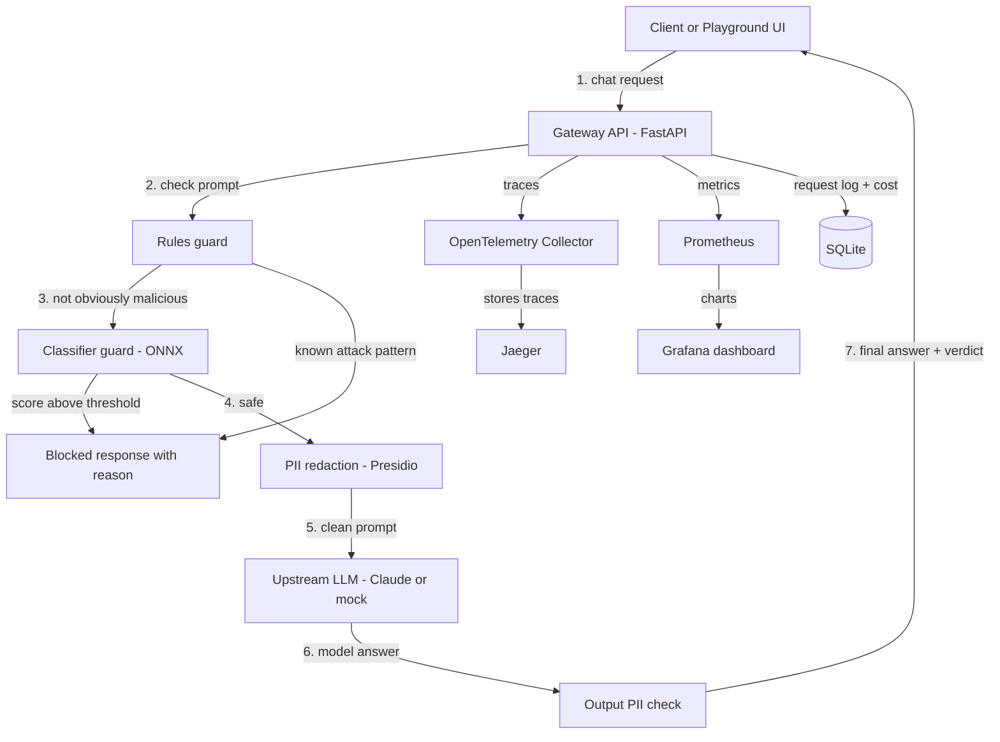

# Secure LLM Gateway: Project Plan

> **For Claude Code:** read this whole file before starting. Section 1 is your operating manual. Follow it exactly.

---

## 0. Before you start (for Charlie, not Claude Code)

Claude Code handles the setup itself (Milestone 0). Only these steps need you, because they involve your accounts, secrets, or how Claude Code itself is launched:

**Use your personal computer only**, never a work laptop (see Section 10).

1. **Log in to GitHub CLI with workflow scope** (needed to push the GitHub Actions file):
   - First time: `gh auth login -s workflow`
   - Already logged in: `gh auth refresh -s workflow`
2. **(Optional) API key for the gateway app.** Claude Code itself runs on your Claude subscription. The *gateway you're building* calls the Claude API, which is billed separately from the subscription. You can skip this step: everything works with the mock upstream, and you can add a key later. If you want real calls now, create a key in the Anthropic Console with a low monthly spend limit.
3. **Open the empty project folder in VS Code** (e.g. `~/code/secure-llm-gateway`) with this file in it, then open the **integrated terminal**. If you made a key, set it under this exact name:
   - macOS / Linux: `export GATEWAY_ANTHROPIC_API_KEY="sk-ant-..."`
   - Windows PowerShell: `$env:GATEWAY_ANTHROPIC_API_KEY="sk-ant-..."`

   **Do not name it `ANTHROPIC_API_KEY` in your shell.** Claude Code uses that variable for its own billing if it finds it, which would charge the whole build to the API key instead of your subscription.
4. **Start Claude Code in that same terminal** in a mode that doesn't stop for approvals:
   ```bash
   claude --dangerously-skip-permissions
   ```
   This lets it run any command without asking. Section 1.3 limits what it should do, but the flag itself has no guardrails, which is why it should be your personal machine.
5. **Send this prompt:**
   > *"Read secure-llm-gateway-plan.md and build the project end to end, starting with Milestone 0 and following Section 1. Do not stop to ask me questions."*

**When you hit your subscription's usage limit,** Claude Code stops and waits; it does not resume by itself after the limit resets. **If the session ends early** (usage limit, crash, laptop sleep), restart Claude Code in the repo and send: *"Read PLAN.md and docs/PROGRESS.md, then continue from where you left off, following Section 1."*

---

## 1. Operating rules for Claude Code (autonomous mode)

Charlie will **not** be at the keyboard while you work. The goal is to make as much progress as possible in one run, then hand back a finished, polished project plus a short list of questions.

### 1.1 Do not stop to ask questions
- **Never pause to ask Charlie anything mid-run.** If something is ambiguous, pick the most reasonable option, write it down, and keep going.
- When you make a choice, log it in `docs/DECISIONS.md` in this format: `Decision | Options considered | Why I picked this | Easy to change? (yes/no)`.
- Put open questions on direction in `docs/QUESTIONS_FOR_CHARLIE.md`. Each question must include **your recommendation** and what you already did in the meantime.

### 1.2 When something blocks you
- **Missing API key or upstream call fails:** switch to the built-in mock upstream (`UPSTREAM=mock`), keep building, and note it in the questions file.
- **A model download fails:** try the fallback model listed in Section 5. If that fails too, run with rules only, keep going, and note it.
- **A tool or library doesn't work:** pick the closest alternative, log the decision, and continue.
- **Tests fail and you can't fix them after a few honest tries:** mark the test `xfail` with a reason, log it in the questions file, and move on. Do not delete tests.
- **A push is rejected** (auth, workflow scope, network): keep committing locally, note it in the questions file, and continue. Never force-push.

### 1.3 Things you must NOT do
- Do not deploy anything to the cloud or create cloud resources. Prepare the deploy config only (Milestone 6).
- Do not spend money beyond normal test calls to the Claude API. Keep eval runs against the real API small (100 requests max per run). Use the mock upstream for everything else.
- Do not commit secrets. `.env` must be in `.gitignore`. Never print the API key in logs or output.
- The GitHub repo stays **private**. Push to it after each milestone, but never change its visibility; Charlie makes it public after review.

### 1.4 How to work
- Work through the milestones **in order**. Finish each milestone's "Done when" checklist before moving on.
- **Commit and push after every milestone** with a clear message, e.g. `M2: add rules and classifier guards`. Smaller commits inside a milestone are fine.
- Keep `docs/PROGRESS.md` updated after every step, not just every milestone: status, what works, what's next. It is your memory if the session restarts or the context gets compacted.
- From M1 on, run `make test` and `make lint` before every commit.
- Look up anything version-sensitive (Claude model IDs, per-token prices, library APIs) in current official docs rather than from memory. Keep the model ID and prices in config, not hardcoded in logic.
- Prefer simple, readable code over clever code. This is a portfolio piece; a reviewer should understand any file in under a minute.
- If you finish everything, continue with the "Stretch" items in Section 9, in order.

### 1.5 When you finish (or run out of budget)
Write `docs/HANDOFF.md` containing:
1. What was built (short bullet list)
2. How to run it (copy-paste commands)
3. Headline results from the eval (numbers)
4. Where the visual assets are (`assets/`)
5. Top 3 to 5 questions on direction, each with your recommendation
6. Anything you skipped or faked (e.g. mock upstream) and why

---

## 2. Goal

**Build a small, polished, open-source LLM security gateway that clearly shows these skills:**
- LLM security: prompt injection and jailbreak detection, PII redaction
- ML in production: serving a small classifier model fast on CPU
- Observability: tracing, metrics, dashboards for LLM traffic
- Evaluation: measuring detection quality and latency cost with real numbers

**The project should look great.** Every piece will later feed a portfolio website, slides, and a demo video, so visuals matter as much as code. Keep the scope small and the finish high-quality. **Showcasing the technologies well beats building lots of features.**

### One-line pitch
A drop-in proxy that sits in front of LLM APIs, blocks prompt injection, redacts PII, and shows exactly what happened to every request, with a playground where visitors can try to break it.

---

## 3. Scope

### In scope
1. **OpenAI-compatible endpoint:** `POST /v1/chat/completions`, so any client works by changing only the base URL.
2. **Upstream:** Claude API (cheapest current Haiku model), plus a **mock upstream** for offline dev, tests, and demos.
3. **Guards (layered, in this order):**
   - **Rules:** regex and heuristics for known injection phrases. Fast, runs first.
   - **Classifier:** a small prompt-injection model run with ONNX Runtime on CPU.
   - **PII redaction:** Microsoft Presidio on the prompt and on the response.
4. **Policy:** one YAML file with thresholds and actions (`allow`, `redact`, `block`).
5. **Observability:** OpenTelemetry traces (one span per step), Prometheus metrics, one Grafana dashboard.
6. **Cost tracking:** tokens and dollar cost per request, stored in SQLite.
7. **Evaluation:** a script that runs public attack datasets plus benign prompts and produces a results table and charts.
8. **Playground UI:** a chat page with a live "what happened" panel next to it.
9. **Visual assets:** charts, screenshots, and a demo script ready for the website and video.

### Out of scope (do not build)
- Streaming responses, multiple providers, user accounts, an LLM-as-judge layer, training a custom model, cloud deployment.

---

## 4. Architecture



Every response includes a `gateway` field (and an `X-Gateway-Verdict` header) with: verdict, which layer decided, scores, redactions made, latency per step, tokens, cost, and trace ID. The playground reads this to draw its side panel.

---

## 5. Stack (keep it to this)

| Piece | Choice |
|---|---|
| Language | Python 3.12, managed with `uv` |
| API | FastAPI + httpx |
| Classifier | `protectai/deberta-v3-base-prompt-injection-v2` exported to ONNX. Fallback: `deepset/deberta-v3-base-injection`. Avoid gated models (they need a Hugging Face login). If neither loads, run rules-only and note it. |
| PII | Microsoft Presidio (analyzer + anonymizer) with spaCy `en_core_web_lg`; fall back to `en_core_web_sm` if the download fails |
| Tracing | OpenTelemetry SDK, OTel Collector, Jaeger |
| Metrics / dashboards | Prometheus + Grafana (dashboard provisioned from JSON) |
| Storage | SQLite |
| UI | Single-page HTML + vanilla JS + Tailwind via CDN, served by FastAPI. No build step. |
| Charts | matplotlib (static PNG/SVG for the site) + Plotly (interactive HTML) |
| Screenshots | Playwright (headless) |
| Quality | ruff, pytest, GitHub Actions workflow file |
| Packaging | Dockerfile + `docker compose up` brings up everything |

---

## 6. Visual design rules (applies to UI, dashboard, charts, README)

The look should be consistent everywhere so screenshots, charts, and slides feel like one product.

- **Dark theme everywhere.** Background `#0B0F17`, panels `#131A26`, borders `#1F2937`, text `#E5E7EB`, muted text `#9CA3AF`.
- **Status colors:** allowed `#22C55E` (green), redacted `#F59E0B` (amber), blocked `#EF4444` (red), accent `#38BDF8` (cyan).
- **Fonts:** Inter for UI, JetBrains Mono for code, scores, and IDs (Google Fonts in the UI; for charts, use them if installed, otherwise the default sans font).
- **Product name:** pick a short, memorable name (log it in DECISIONS.md) and make a simple SVG logo (a shield shape plus the name). Use it in the UI, README, and charts.
- **Charts:** dark background, same palette, large readable labels, a title that states the takeaway (e.g. "Classifier catches 3x more attacks than rules alone"), no chart junk. Export each as both PNG (1600px wide) and SVG to `assets/charts/`.
- **Playground:** two columns. Left: chat. Right: a "request inspector" showing the pipeline as steps (Rules → Classifier → PII → LLM → Output check), each step lighting up green/amber/red with its latency in ms. Add 4 to 6 one-click example buttons (e.g. "Ignore previous instructions", "Leak an SSN", "Normal question", "Role-play jailbreak").
- **Grafana dashboard:** dark theme, top row of big stat panels (requests, block rate, p95 added latency, cost today), then time series below.

---

## 7. Milestones

### M0: Environment setup (Claude Code does all of this)
1. **Check tools:** `git`, `gh`, `docker`, `uv`, Python 3.12. Install any that are missing (`uv` via its install script, Python via `uv python install 3.12`). If `gh` is not logged in, skip GitHub steps, work with a local git repo, and note it in the questions file.
2. **Docker:** check `docker info`. If the daemon isn't running, try to start it (`open -a Docker` on macOS, `Start-Process "Docker Desktop"` on Windows) and wait up to 2 minutes. If it still isn't up, continue building everything that doesn't need Docker and do the Docker parts last.
3. **Internet:** confirm access to PyPI and Hugging Face with a quick request. If Hugging Face is unreachable, use the rules-only fallback (Section 1.2).
4. **Repo:** `git init`, then `gh repo create secure-llm-gateway --private --source=. --remote=origin`.
5. **Plan:** rename this file to `PLAN.md` in the repo root.
6. **Secrets:** add `.env` to `.gitignore` **first**. Create `.env.example` with placeholder values. Then create `.env` by writing the value of the `GATEWAY_ANTHROPIC_API_KEY` shell variable into it as `ANTHROPIC_API_KEY=...`, using a script, without ever printing it. Do not set `ANTHROPIC_API_KEY` in the shell environment. If the variable is empty, set `UPSTREAM=mock` and note it in the questions file. Run `git status` before committing to confirm `.env` is not staged.
7. **Dev container:** add a `.devcontainer/devcontainer.json` (Python 3.12, Docker-in-Docker, uv) so future runs can happen in an isolated container.
8. **Docs:** create `docs/` with empty `DECISIONS.md`, `QUESTIONS_FOR_CHARLIE.md`, and `PROGRESS.md`.
9. Commit (`M0: project setup`) and push.

**Done when:** the private repo exists on GitHub with the plan, `.gitignore`, `.env.example`, dev container config, and docs folder, and no secrets are committed.

### M1: Skeleton and pass-through proxy
- Repo layout, `pyproject.toml`, `Makefile` (`run`, `test`, `lint`, `traffic`, `eval`, `assets`).
- `/v1/chat/completions` forwarding to Claude, with the mock upstream behind `UPSTREAM=mock`.
- Token counting and cost per request, saved to SQLite.
- `/healthz` endpoint.

**Done when:** the OpenAI Python client works against the gateway by changing only `base_url`, and tests pass with the mock upstream.

### M2: Guards and policy
- Rules guard with unit tests (attack and benign examples).
- Classifier guard: download, export to ONNX, load once at startup, measure CPU latency.
- PII redaction on input and output.
- `policy.yaml` with thresholds and actions.
- The `gateway` verdict field on every response.

**Done when:** a known attack is blocked with a clear reason, an SSN in the prompt is redacted, a normal question passes, all covered by tests.

### M3: Observability
- OTel spans for each step, linked under one trace per request.
- Prometheus metrics: request count, blocks by layer and reason, latency histograms per step, tokens, cost.
- Docker Compose: gateway, OTel Collector, Jaeger, Prometheus, Grafana (auto-provisioned dashboard and datasources, anonymous viewer access enabled so screenshots work without a login).
- A small traffic generator script (`scripts/traffic.py`) that sends a realistic mix of benign and attack prompts against the mock upstream, so the dashboard has data.

**Done when:** `docker compose up` plus `make traffic` gives a populated Grafana dashboard and clickable traces in Jaeger.

### M4: Evaluation
- Datasets: one or two public prompt-injection / jailbreak datasets from Hugging Face, plus a benign set (normal user questions) for false positives. Log which ones you used and their licenses in DECISIONS.md.
- Also write ~30 hand-crafted attacks into `eval/holdout.jsonl` that are not from any public set, to check the classifier isn't just memorizing.
- `eval/run_eval.py` measures guards only (no upstream calls needed).
- Configurations to compare: rules only, classifier only, rules + classifier.
- Metrics: precision, recall, F1, false positive rate on benign, latency p50/p95 per layer.
- Output `eval/results/results.json` and a markdown table.
- Cost per 1K requests: compute from token counts and the configured prices, checked against one small real run (100 requests max) if the API key works.

**Done when:** `make eval` regenerates all numbers from scratch.

### M5: Playground UI
- Build the playground following Section 6.
- Served at `/` by the gateway.
- Works fully with the mock upstream (so the demo never depends on an API key).

**Done when:** each example button produces the right colored pipeline in the inspector.

### M6: Visual assets and portfolio kit
- `make assets` generates everything into `assets/`:
  - `charts/`: ablation bar chart (recall and false positive rate by config), latency per layer chart, precision/recall chart, cost per 1K requests. PNG + SVG each, plus one interactive Plotly HTML page combining them.
  - `screenshots/`: Playwright captures of the playground (one per example button), the Grafana dashboard, and a Jaeger trace.
  - `diagram/`: architecture diagram exported as SVG and PNG in the dark palette.
- `docs/DEMO_SCRIPT.md`: a 2 minute video script with shot list (what to click, what to say, in order).
- `docs/SLIDES_OUTLINE.md`: a 6 to 8 slide outline (problem, architecture, demo, results, lessons), naming which asset goes on each slide.
- `docs/PORTFOLIO_CARD.md`: title, one-line pitch, headline metric, 3 bullets, tech tags, and the draft CV bullet with real numbers filled in.
- `deploy/`: a Cloud Run (or Fly.io) config with rate limiting, token caps, and a daily spend cap. **Prepare only; do not deploy.**

**Done when:** `make assets` runs clean, and every asset looks consistent with Section 6.

### M7: README and handoff
- README: logo, one-line pitch, hero screenshot or GIF, architecture diagram, results table, quickstart (3 commands), "how it works" section, limitations.
- Final pass: lint, tests, fresh-clone run of `docker compose up`.
- Write `docs/HANDOFF.md` (Section 1.5).

**Done when:** a stranger could clone the repo and see the demo in under 5 minutes.

---

## 8. Metrics to report

| Metric | What it shows |
|---|---|
| Recall on attacks | how many attacks get caught |
| False positive rate on benign prompts | whether it blocks normal users |
| Precision / F1 | overall detection quality |
| Added latency p50 / p95, per layer | the cost of safety |
| Cost per 1K requests | dollar overhead |
| Holdout recall vs public-set recall | whether it generalizes |

Headline format for the website: **"Catches X% of prompt-injection attacks with Y% false positives, adding Z ms p95 latency."**

---

## 9. Stretch (only after M7 is done, in this order)

1. GIF of the playground for the README (Playwright recording converted to GIF).
2. Load test with Locust: throughput and latency chart.
3. Streaming support.
4. LLM-as-judge layer for borderline scores, added to the ablation.

---

## 10. Boundaries

- Personal project: public data and open-source models only.
- No connection to or code from Charlie's employer.

---

## 11. Repo layout (target)

```
secure-llm-gateway/
  PLAN.md
  README.md
  Makefile
  pyproject.toml
  docker-compose.yml
  Dockerfile
  policy.yaml
  .env.example
  gateway/          # FastAPI app, guards, upstreams, telemetry, cost
  ui/               # playground (index.html, js, logo)
  eval/             # datasets loader, holdout.jsonl, run_eval.py, results/
  scripts/          # traffic.py, make_charts.py, screenshots.py
  observability/    # otel collector, prometheus, grafana provisioning
  deploy/           # prepared cloud config (not deployed)
  assets/           # charts, screenshots, diagram
  docs/             # DECISIONS, QUESTIONS_FOR_CHARLIE, PROGRESS, HANDOFF, DEMO_SCRIPT, SLIDES_OUTLINE, PORTFOLIO_CARD
  tests/
```
