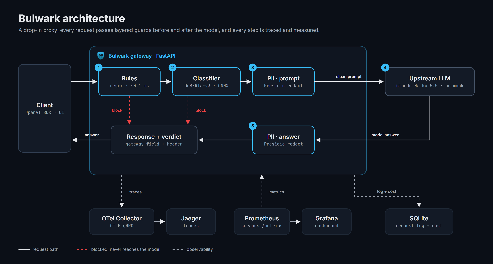
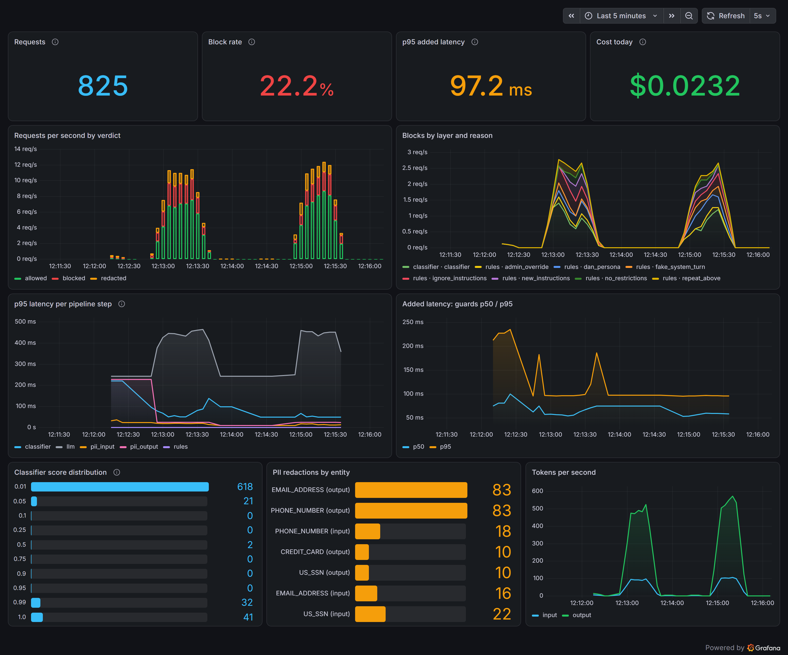
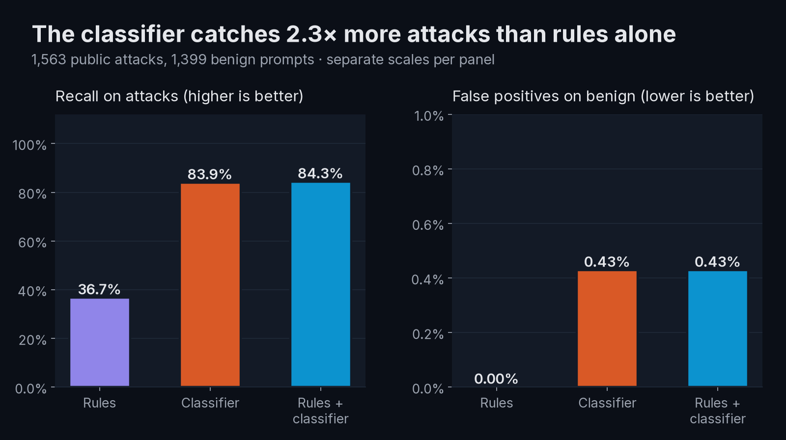
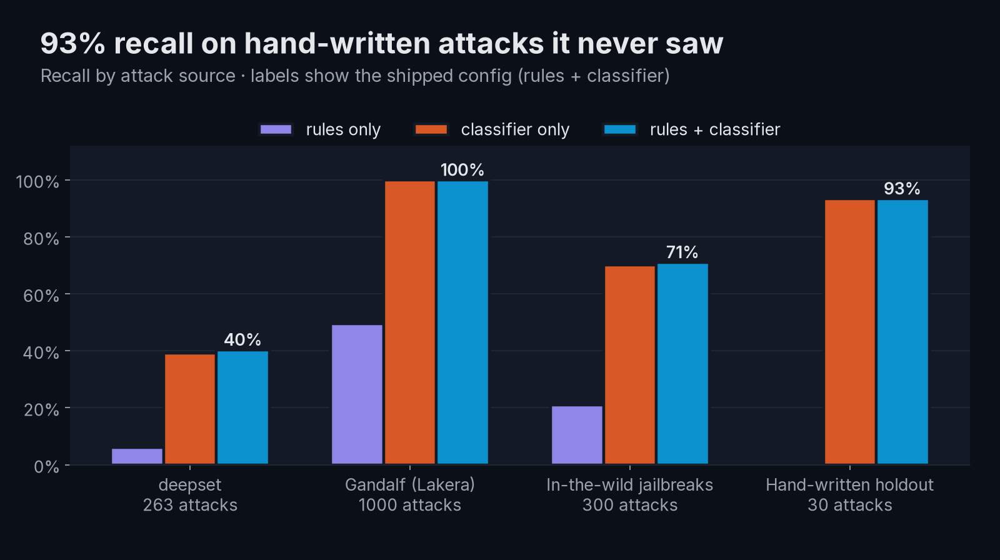
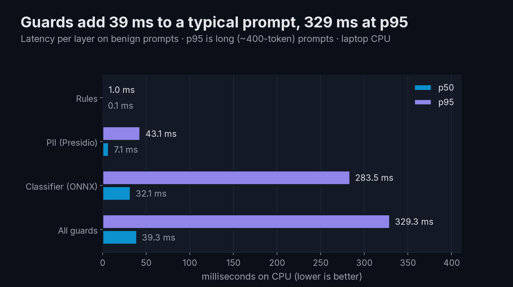
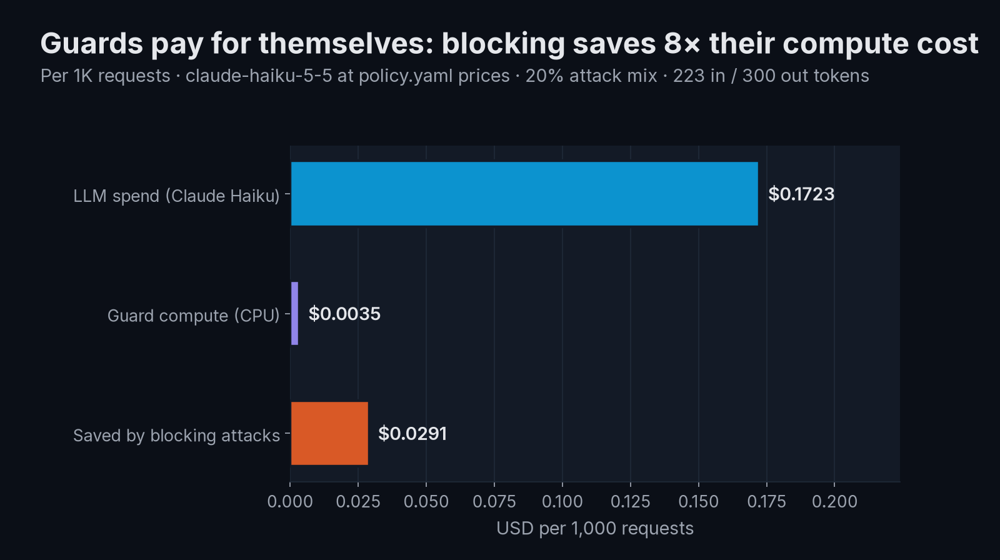

<p align="center">
  
</p>

<h1 align="center">Bulwark</h1>

<p align="center">
  <b>A drop-in security gateway for LLM apps.</b><br>
  It blocks prompt injection, redacts PII, and shows exactly what happened to every request.
</p>

<p align="center">
  
</p>

| | |
|---|---|
| **Catches 84% of prompt-injection attacks** | across ~3,000 public and hand-written prompts |
| **0.4% false positives** | on 1,400 benign prompts |
| **93% recall on unseen attacks** | 30 hand-written attacks not in any dataset |
| **+39 ms median latency** | all guards on CPU (329 ms p95 for long prompts) |

Point any OpenAI-compatible client at Bulwark by changing one line:

```python
from openai import OpenAI

client = OpenAI(base_url="http://localhost:8000/v1", api_key="unused")
```

## Quickstart

```bash
git clone https://github.com/Charlie-Gzz/secure-llm-gateway && cd secure-llm-gateway
docker compose up -d --build        # first build downloads the ~740 MB classifier
open http://localhost:8000          # playground (Windows: start http://localhost:8000)
```

| URL | What |
|---|---|
| http://localhost:8000 | Playground: try to break it |
| http://localhost:3000 | Grafana dashboard (no login) |
| http://localhost:16686 | Jaeger traces |

It runs fully offline against a built-in **mock upstream**, so no API key is needed. To use Claude,
copy `.env.example` to `.env`, set `ANTHROPIC_API_KEY`, and set `UPSTREAM=anthropic`.
Run `make traffic` to fill the dashboard.

## How it works

<p align="center"></p>

Every request goes through the guards in order, cheapest first. If a guard blocks a request, it never reaches the model and costs nothing.

1. **Rules** ([gateway/guards/rules.py](gateway/guards/rules.py)): regexes for well-known injection and jailbreak phrasing ("ignore previous instructions", fake `<|im_start|>system` turns, DAN prompts). Unicode is normalized first, so zero-width characters and full-width letters don't slip through. Takes ~0.1 ms.
2. **Classifier** ([gateway/guards/classifier.py](gateway/guards/classifier.py)): [`protectai/deberta-v3-base-prompt-injection-v2`](https://huggingface.co/protectai/deberta-v3-base-prompt-injection-v2), served with ONNX Runtime on CPU and loaded once at startup. Long prompts are scored in overlapping 512-token windows, so an attack can't hide after a page of filler.
3. **PII redaction** ([gateway/guards/pii.py](gateway/guards/pii.py)): Microsoft Presidio replaces SSNs, cards, emails, phone numbers, IBANs, passports, and IPs with placeholders like `<US_SSN>`, on the prompt **and** the model's answer.
4. **Policy** ([policy.yaml](policy.yaml)): one file holds the thresholds, the action for each guard (`allow` / `redact` / `block`), the model ID, and per-token prices.

Every response carries a `gateway` field and an `X-Gateway-Verdict` header. They contain the verdict, the deciding layer and reason, the scores, the redactions, latency per step, tokens, cost, and the trace ID. The playground draws its inspector from this field.

**Observability:** each request is one OpenTelemetry trace with a span per step. Prometheus scrapes `/metrics` (requests by verdict, blocks by layer and reason, latency histograms per step, tokens, and cost), and Grafana shows them on a provisioned dashboard. SQLite keeps a per-request cost log.

<p align="center"></p>

## Results

`make eval` regenerates every number from scratch. It needs no API calls. Full report: [eval/results/results.md](eval/results/results.md).

| Config | Precision | Recall | F1 | False-positive rate |
|---|---:|---:|---:|---:|
| Rules only | 100.0% | 36.7% | 53.7% | 0.0% |
| Classifier only | 99.5% | 83.9% | 91.1% | 0.4% |
| **Rules + classifier (shipped)** | **99.5%** | **84.3%** | **91.3%** | **0.4%** |

<p align="center">
  
  
  
  
</p>

- **Datasets:** `deepset/prompt-injections`, `Lakera/gandalf_ignore_instructions`, `TrustAIRLab/in-the-wild-jailbreak-prompts`, and `HuggingFaceH4/no_robots` (benign). None of them is in the classifier's training data. There's also a hand-written holdout of 30 attacks and 30 near-miss benign prompts ([eval/holdout.jsonl](eval/holdout.jsonl)).
- **Cost per 1K requests:** about $0.17 of Claude Haiku spend. The guards add $0.004 of CPU time, and blocking attacks saves about $0.03.
- **What the ablation shows:** the classifier does the heavy lifting. Rules add little recall on top, but they're explainable and skip the classifier for obvious attacks.

[Interactive charts](assets/charts/index.html) · [Demo script](docs/DEMO_SCRIPT.md) · [Design decisions](docs/DECISIONS.md)

## Limitations

These are measured, not guessed:

- **English only.** About 40% of missed attacks in the deepset set are in German (by a simple keyword check).
- **Role-play jailbreaks** are only partly covered (71% recall on in-the-wild jailbreaks). The model card says it doesn't target jailbreaks.
- **Some indirect injections slip through.** An email asking the assistant to forward the user's inbox scored 0.20.
- **The classifier has known false-positive patterns.** It flags "remember X for later" and terse commands like "Log me please".
- **p95 latency grows with prompt length.** It's ~490 ms at 400 tokens on a laptop CPU. A GPU or a distilled model would fix this.
- **int8 quantization was tried and rejected.** It made the model 3× smaller and destroyed its accuracy.
- **No streaming yet,** and the rate limiter is in-memory, so it's single-instance only.

## Development

```bash
make setup     # uv sync + download the ONNX classifier
make run       # gateway on :8000 (mock upstream by default)
make test      # pytest, offline
make lint      # ruff
make eval      # regenerate eval/results
make assets    # charts, diagram, screenshots (needs the stack running)
```

The stack is Python 3.12, FastAPI, ONNX Runtime, Presidio, spaCy, OpenTelemetry, Jaeger, Prometheus, Grafana, SQLite, Tailwind, matplotlib, Plotly, and Playwright.

Deployment configs for Cloud Run and Fly.io are in [deploy/](deploy/), with a rate limit, a prompt-size cap, and a daily spend cap. They are prepared but not deployed.

## License

MIT. The bundled Inter and JetBrains Mono fonts are under the SIL Open Font License (see [assets/fonts/](assets/fonts/)).
